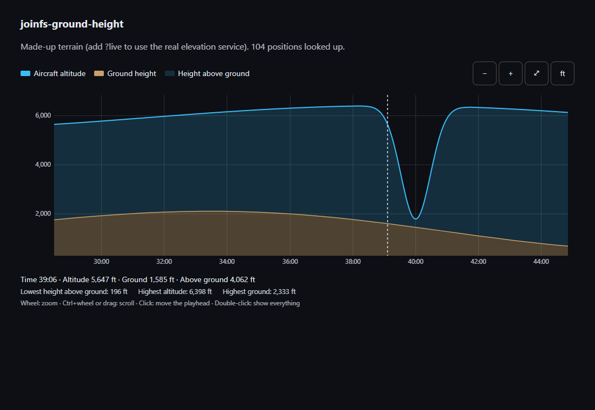
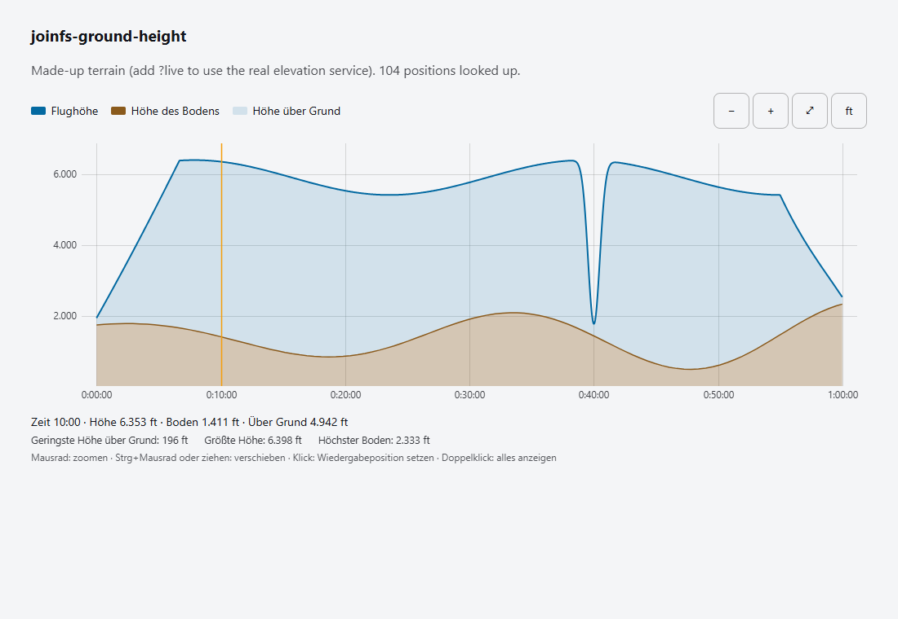

# joinfs-ground-height

Ground height along a flight track, and a chart that shows it next to the aircraft altitude. Made for the
[JoinFS recording toolkit](https://github.com/joeherwig/joinfs-recording-toolkit), usable on its own.

It has two parts in one script:

- **`JoinfsGroundHeight`**: pure functions that look the terrain height up for a thinned-out set of a track's positions and
  derive the height above ground. They also run in node.
- **`<joinfs-ground-profile>`**: a zoomable, scrollable diagram of **one** aircraft: altitude, terrain, and the height above
  ground between them.


Zoomed in on the low pass (the dashed line follows the pointer, the line above shows the values there):



On a light page and in German (the language follows the `lang` attribute or the browser):



## Use

```html
<script src="joinfs-ground-height.js"></script>
<joinfs-ground-profile id="chart" unit="ft"></joinfs-ground-profile>
<script>
  // frames: { times (s), lat (deg), lon (deg), alt (m) } as typed arrays or arrays
  JoinfsGroundHeight.computeProfile(frames).then((ground) => {
    chart.data = { name: 'D-ABCD', times: frames.times, alt: frames.alt, ground };
    chart.playhead = 600;                                   // optional, seconds
    chart.addEventListener('seek', (e) => { chart.playhead = e.detail.time; });
  });
</script>
```

`demo/index.html` does exactly this with a made-up flight and terrain (add `?live` for the real service, `?lang=de`,
`?theme=dark`).

### The chart

| | |
|---|---|
| Attributes | `lang` (observed, see Languages), `unit` (`ft` default, or `m`; the unit button on the chart changes it), `locale-base` (folder of the locale files, default: the folder of this script) |
| `data` | `{ name, times, alt, ground }`: `times` in seconds (the x axis, any origin), `alt` in metres, `ground` is `{ times, height }` from `computeProfile` or `null` (then only the altitude is drawn) |
| `playhead` | seconds, or `null`; drawn as an amber line |
| Methods | `zoomIn()`, `zoomOut()`, `fit()` |
| Event | `seek`, `detail { time }`: the user clicked the diagram |

Mouse: wheel zooms around the pointer, drag or Ctrl+wheel (also Shift+wheel, horizontal wheel) scrolls, click moves the
playhead, double-click shows everything. Touch: drag, pinch. Keyboard (focus the diagram): arrows scroll, `+` `-` zoom,
`Home` shows everything. Every action also has a button.

### The functions

| Function | Result |
|---|---|
| `computeProfile(frames, opts)` | `Promise<{ times, height, source, points }>`: times in the track's time, height in metres. `opts`: `spacingM` (250), `maxPoints` (600), `maxGapS` (60), `provider`, `signal`, `onProgress(done, total)`, `fetch`, `retries` |
| `interpolate(profile, t)` | ground height at `t` (linear, held before the first and after the last point) |
| `aglSeries(frames, profile)` | `Float32Array`, altitude minus ground height per frame, `NaN` without a valid position |
| `statistics(times, alt, profile)` | `{ minAgl, minAglTime, maxAlt, maxGround }` |
| `fetchElevations(coords, opts)` | the lookup itself for `[{ lat, lon }]` |
| `pickSamples(frames, opts)` | the frame indices `computeProfile` would look up |

Errors are `GroundHeightError` with a `code`: `noPositions`, `network`, `http`, `rateLimited`, `badResponse`, `aborted`.
Positions at exactly 0/0 are treated as "no fix" and skipped, like the toolkit does.

## Where the heights come from, and privacy

By default [Open-Meteo's elevation API](https://open-meteo.com/en/docs/elevation-api) is asked (Copernicus 90 m terrain
model, 100 positions per request, free for non-commercial use, no key). **The sampled positions of the track (rounded to
about 11 m, one every 250 m or so, at most about 600 per track) are sent to open-meteo.com.** Nothing else leaves the
browser. The chart itself never talks to a server.

Because the model has a 90 m grid and the track is sampled, the ground height is an estimate: it is good enough to see
terrain clearance, not to judge a runway. Open sea has no data and counts as 0 m. To use another service (or your own
data), pass `provider: async (batch) => [heights in metres]` for a `batch` of `{ lat, lon }`.

## Languages

English is built into the script. Every other language is a file `joinfs-ground-height-<locale>.json` **in the same folder as
the script**: `de, es, fr, it, ko, nl, pt, uk` (what JoinFS ships, plus Ukrainian). The element's `lang` attribute picks the
language (changeable at runtime), else the browser's languages, else English; `de-AT` becomes `de`. The files are fetched
lazily; if that fails (for instance from `file://`) a warning goes to the console and the chart stays in English.

To add or fix a translation edit `tools/make-locales.cjs` and run `npm run locales`. `npm test` checks that all locale
files have exactly the keys and placeholders of the English dictionary. The German uses the informal "du".

## Develop

```
npm test        # node >= 22
npm run locales
```

License: CC BY-NC-SA 4.0 (see [LICENSE](LICENSE) and [NOTICE.md](NOTICE.md)).
