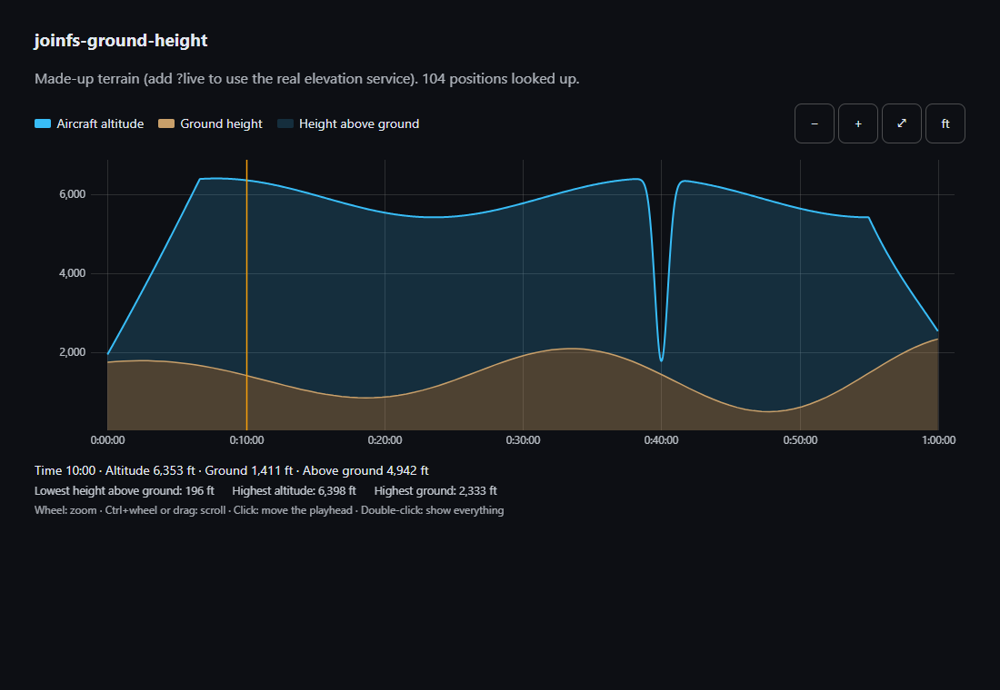

# joinfs-ground-height

Two things for JoinFS recordings, in one script:

- **Ground height lookup:** for a flight track (times, latitude, longitude, altitude) it looks up the terrain height under a
  thinned-out set of positions and derives the **height above ground**.
- **`<joinfs-ground-profile>`:** a zoomable, scrollable diagram of **one** aircraft: altitude, terrain and the height above
  ground between them.

It is built for the [JoinFS recording toolkit](https://github.com/joeherwig/JoinFS-recording-toolkit), where it is the
`ground-height` plugin, but it has no dependency and runs in any page (and the lookup functions in node).

## Where to start

| I want to... | Read |
|---|---|
| show a flight's altitude and terrain in a page | [Embedding in a Page](Embedding-in-a-Page) |
| zoom, scroll, read values off the diagram | [Using the Chart](Using-the-Chart) |
| know where the heights come from, what is sent, how exact it is | [Ground Height Data](Ground-Height-Data) |
| use another language | [Languages](Languages) |

## Related projects

- [JoinFS-recording-toolkit](https://github.com/joeherwig/JoinFS-recording-toolkit): the host application.
- [joinfs-gpx-to-jfs-webcomponent](https://github.com/joeherwig/joinfs-gpx-to-jfs-webcomponent) and
  [joinfs-igc-to-jfs-webcomponent](https://github.com/joeherwig/joinfs-igc-to-jfs-webcomponent): the converters that produce
  the recordings.
